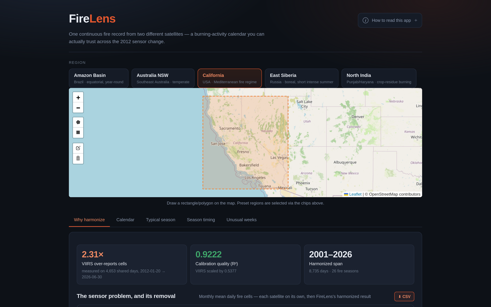

# FireLens

**One continuous fire record from two different satellites — a burning-activity calendar you can trust across the 2012 sensor change.**

NASA Space Apps Challenge 2026 · *Harmonization of MODIS and VIIRS Hot Spots*

team **scikit** — M. Shahmir Khan · Ahmed Bilal · Abbas Bajwa · Azwar Khan · Sajid Islam

---

## Demo

A ~80-second silent screencast of the app is at **[`docs/firelens_demo.mp4`](docs/firelens_demo.mp4)**, with the narration script and shot list in [`docs/VIDEO_SCRIPT.md`](docs/VIDEO_SCRIPT.md) and a slide deck in [`docs/DECK.md`](docs/DECK.md).



---

## The problem

NASA FIRMS publishes active-fire hotspots from two satellites that have **very different spatial resolutions**:

| Sensor | Resolution | Overpasses/day | Archive |
|---|---|---|---|
| **MODIS** (C6.1, Terra/Aqua) | 1 km | 4 | 2001 → present |
| **VIIRS** (S-NPP) | 375 m | 2 | 2012 → present |

Both sensors observe *the same fires*, but they report very different numbers of them. Measured directly on days when both observed the same region, VIIRS counts **2.2× to 4.9×** as many distinct fire cells as MODIS.

Critically, the two archives **overlap for roughly 14 years** (2012 → present), not merely hand off at a single date. That overlap is what makes the problem measurable rather than a matter of opinion: for more than a decade we can watch both instruments look at the same burning ground and disagree.

Anyone building a long-term fire dataset has to pick one of two bad options. Joining the archives without correction invents a trend that never happened — activity appears to explode after 2012 because the satellite changed, not the planet. Dropping either sensor throws away half the record. FireLens does the third thing: it puts both eras on **one consistent scale**, using the overlap period to fit the correction rather than guessing at it.

---

## What it does

1. **Downloads** 26 years of MODIS + 15 years of VIIRS hotspots for five regions (26.2M raw detections).
2. **Cleans** them (confidence thresholds, removes volcano/offshore types, drops zero-FRP rows).
3. **Grids** all detections onto a common ~1 km H3 lattice, so pixel size no longer drives the count.
4. **Calibrates** VIIRS onto the MODIS scale using the 2012→present overlap period, fitting a per-region regression.
5. **Publishes** the result as an interactive burning-activity calendar.

The output is a single, defensible "burning activity" series from 2001 to the present — where a change year-over-year reflects **real change in fire activity**, not a change of satellite.

### Measured effect

The clearest demonstration is the sensor disagreement itself. Over the months where both satellites observed each region, the median ratio of VIIRS to MODIS fire cells is:

| Region | VIIRS / MODIS (median, overlap months) |
|---|---|
| North India | **4.27×** |
| Australia NSW | **2.66×** |
| Amazon | **2.30×** |
| East Siberia | **2.26×** |
| California | **1.98×** |

Leaving that uncorrected would show North Indian burning activity quadrupling the moment you switched archives — with no change on the ground. After calibration, the harmonized series tracks MODIS closely across the overlap (median deviation well under one month-to-month noise band), which is the check that the regression actually works.

---

## Results

All five regions, calibrated on their 2012→present overlap:

| Region | VIIRS over-report | FRP ratio | Overlap days | Calibration R² | Peak week | Busiest year |
|---|---|---|---|---|---|---|
| California | 2.31× | 0.49 | 4,653 | 0.922 | 36 (early Sep) | 2020 |
| North India | 4.90× | 1.69 | 4,327 | **0.586** | 44 (early Nov) | 2016 |
| Amazon Basin | 2.31× | 0.89 | 5,090 | 0.901 | 36 (early Sep) | 2005 |
| Australia NSW | 2.98× | 0.74 | 4,946 | 0.917 | 16 (mid Apr) | 2019 |
| East Siberia | 2.41× | 0.59 | 3,506 | 0.952 | 29 (mid Jul) | 2003 |

Total raw detections processed: **28,287,761** across 5 regions (~580 MB of parquet), yielding **42,949** harmonized region-days and **6,910,569** cell-days. Each region yields ~7,800–9,100 days of harmonized record and 26 fire seasons. East Siberia is lowest because its high-latitude box has no detections in deep winter, so it contributes ~320 observed days per year rather than ~360.

> **Known weakness — North India (R² 0.586).** Its 4.9× inflation and sharply-peaked Oct–Nov crop-residue burning are far outside what the other regions show, so the linear overlap fit explains much less variance there. The trend is likely genuine (agricultural burning is a distinct regime from wildfire), but the calibration is the least trustworthy of the five. Flagged rather than hidden; would want a regime-aware or nonlinear fit before treating it as quantitative.

---

## The web app

Five views, each with a **"What am I looking at?"** explainer and hover/click readouts:

1. **Why harmonize** — MODIS, VIIRS, and the harmonized result on one axis, so you can watch the two satellites disagree over 14 years of overlap and see the correction bring them together. Each series is toggleable. Default view.
2. **Calendar** — one row per year, one square per day, sequential colour ramp. The fire season is visible as a drifting band.
3. **Typical season** — weekly median with a 10th–90th percentile band (narrow band = predictable season, wide = volatile).
4. **Season timing** — per-year start/peak/end bars, with a computed season-drift trend.
5. **Unusual weeks** — weeks ranked by anomaly, in units of the local p10–p90 spread (a robust stand-in for σ that is not fooled by a single extreme week), so a score means the same thing in a stable region and a volatile one.

Regions: California, North India (crop residue), Amazon Basin, Australia NSW, East Siberia — chosen to span Mediterranean, monsoon, equatorial, temperate, and boreal fire regimes.

---

## Quick start

### Prerequisites
- Python 3.11+ · Node 18+
- A free [FIRMS MAP_KEY](https://firms.modaps.eosdis.nasa.gov/api/map_key/) (requires an [Earthdata Login](https://urs.earthdata.nasa.gov/))

### 0. Bootstrap the environment (one command)

```bash
scripts/bootstrap.sh          # creates .venv, installs Python + frontend deps
scripts/bootstrap.sh --dev    # ...and pytest/httpx for the test suite
```

### 1. Fetch the data

```bash
python3 -m venv .venv && source .venv/bin/activate
pip install -r backend/requirements.txt

export FIRMS_MAP_KEY=your_key_here
python scripts/download_firms.py --aois california --products MODIS_SP VIIRS_SNPP_SP --years 2001-2026
```

The FIRMS area API accepts **max 5 days per request**, so the downloader batches automatically. It is slow by nature (tens of thousands of API calls) and resumable:

```bash
python scripts/download_firms.py --aois california --products MODIS_SP VIIRS_SNPP_SP --years 2001-2026 --resume
```

> **Completeness is tracked explicitly.** A year only gets an `.ok` sidecar next to its `.parquet` when *every* 5-day window in that year returned data; any failed window prints an `INCOMPLETE` warning and leaves the sidecar off. `--resume` trusts only those sidecars. This exists because an earlier version wrote whatever it had when a run was interrupted and then skipped the truncated file forever — which silently left 8 year-files holding 4 days of data each (NSW MODIS 2009/2013/2017/2021/2025, East Siberia VIIRS 2017/2021/2025). To re-fetch anything downloaded before sidecars existed:

```bash
python scripts/download_firms.py --aois australia-nsw --products MODIS_SP --years 2001-2026 --verify
```

Long jobs must be detached to survive a dropped connection:

```bash
python scripts/daemon.py --log logs/download.log --cmd python scripts/download_firms.py --aois east-siberia --products MODIS_SP VIIRS_SNPP_SP --years 2001-2026 --resume
```

> Note the API takes the **source key** (`MODIS_SP`, `VIIRS_SNPP_SP`), not the descriptive labels in the `PRODUCTS` config dict — passing the label yields a generic `Invalid source.` 400. Rate limit is 5000 transactions per 10 minutes. The VIIRS S-NPP archive is scheduled for retirement, so download it before Nov 2026.

> ⚠️ **Time-sensitive:** the Suomi NPP VIIRS feed ends **1 Nov 2026**. Pull the S-NPP archive before then; NOAA-20 is the forward-looking replacement.

### 2. Run the pipeline

```bash
python scripts/check_data.py                     # integrity: every year has data / .ok, flags gaps
python scripts/build_pipeline.py --aoi california
# ...or every region at once (checks integrity first, prints per-region timings):
scripts/build_all.sh
```

Outputs land in `data/processed/<aoi>/`: `calibration.csv`, `climatology.csv`, `peak_season.csv`, `anomalies.csv`, `calendar_grid.csv`, `merged.parquet`, `meta.json`. A full `scripts/build_all.sh` run over all five regions takes ~11 minutes (Amazon and East Siberia dominate; they chunk the daily aggregation by year).

### 2b. Run the tests

```bash
.venv/bin/pip install -r requirements-dev.txt    # pytest + httpx
.venv/bin/python -m pytest tests/ -q
```

`tests/test_pipeline.py` pins the calendar math on synthetic data; `tests/test_artifacts.py` checks every built artifact's structural invariants; `tests/test_api.py` exercises all endpoints against the real data via FastAPI's TestClient.

### 3. Run the app

Two terminals:

```bash
# Terminal 1 — API
source .venv/bin/activate
uvicorn backend.app:app --host 127.0.0.1 --port 8000

# Terminal 2 — frontend
cd frontend
npm install
npm run build      # build before preview, or preview serves a stale bundle
npx vite preview --host 127.0.0.1 --port 4173
```

Open **http://127.0.0.1:4173**. The frontend proxies `/api` → `127.0.0.1:8000`.

---

## How it works

### Pipeline stages

```
FIRMS API
   │
   ├─ 1. CLEAN      drop confidence 'low' (VIIRS) / <25 (MODIS),
   │                remove types {2 volcano, 3 static/offshore}, drop FRP ≤ 0
   │
   ├─ 2. GRID       lat/lon → H3 resolution 8 (~0.7 km²)  ← kills pixel-size inflation
   │                per day: count unique fire cells, sum FRP
   │
   ├─ 3. CALIBRATE  OLS  MODIS ~ a + b·VIIRS   fit on 2012→present overlap
   │                every day where MODIS observed keeps its measured value;
   │                MODIS gaps fall back to calibrated VIIRS, floored at 0
   │
   │                merged.parquet keeps all three columns side by side
   │                (…_modis, …_viirs, …_harmonized) so the correction
   │                stays auditable rather than being baked in
   │
   └─ 4. CALENDAR   weekly climatology (p10/median/p90)
                    anomalies  = (value − median) / (p90 − p10)
                    peak season = cumulative 20% / argmax / cumulative 90%
                    year × day-of-year grid for the heatmap
```

### Why gridding matters

Counting raw detections is not a fair comparison: a 375 m pixel is ~7× finer than a 1 km pixel, so finer-resolution sensors mechanically find more "hot spots" in the same fire. Re-gridding both sensors onto an identical ~1 km lattice collapses most of the difference before calibration even runs.

Measured on California (single test day): raw detections were **4.0×** higher for VIIRS; after H3 gridding, **1.52×**.

```bash
python scripts/check_inflation.py
```

### Why the FRP ratio is interesting

Across regions, VIIRS's *fire-pixel* count runs 2.2–4.9× above MODIS, but its **Fire Radiative Power sums to 0.50–0.89×** of MODIS (the exception being North India at 1.69×). The two sensors disagree about *how much is burning* versus *how hot*. That divergence is why calibration is fitted per-region on the local overlap rather than applied globally — and why `unique_cells` is used as the harmonized metric rather than FRP.

### API

| Endpoint | Returns |
|---|---|
| `GET /aois` | list of processed regions |
| `GET /aoi/{aoi}/summary` | headline stats: inflation factor, calibration R², peak week, busiest year, overlap facts |
| `GET /aoi/{aoi}/calendar` | `years[]`, `day_of_year[]`, `grid[][]` |
| `GET /aoi/{aoi}/climatology` | `weeks[]`, `p10[]`, `median[]`, `p90[]` |
| `GET /aoi/{aoi}/peak-season` | per-year `start_week`, `peak_week`, `end_week`, `annual_total` |
| `GET /aoi/{aoi}/anomalies` | per-year-week `value`, `median`, `anomaly` |
| `GET /aoi/{aoi}/comparison` | aligned `modis[]`, `viirs[]`, `harmonized[]` daily series (null where a sensor is absent) — what the "Why harmonize" chart renders |
| `GET /aoi/{aoi}/timeseries?sensor=raw\|harmonized` | single daily series, either the naive unscaled splice or the calibrated output |
| `GET /aoi/{aoi}/calibration` | `intercept`, `slope`, `r2`, `overlap_start` |
| `POST /cache/clear[?aoi=…]` | drop cached artifacts (optionally one region) and re-warm |
| `GET /cache/status` | per-region file stamps + cache hit/miss counters |

Artifacts are cached in memory and warmed at startup, so page loads don't wait on disk.

**The cache self-invalidates.** Every cache key embeds the newest mtime across that
region's files (in both `data/processed/` and `data/daily/`), so re-running the pipeline
for a region changes the key and the API serves fresh data **without a restart**. To force
a reload manually or reclaim memory:

```bash
curl -X POST 'localhost:8000/cache/clear'              # all regions, then re-warm
curl -X POST 'localhost:8000/cache/clear?aoi=amazon'   # one region
curl 'localhost:8000/cache/status'                     # inspect stamps + hit rates
```

---

## Project layout

```
firelens/
├── scripts/
│   ├── bootstrap.sh           one-command env setup (venv + deps + npm ci)
│   ├── check_data.py          raw-data integrity guard (.ok + day-count heuristic)
│   ├── build_all.sh           check + rebuild all five regions, with timings
│   ├── download_firms.py      FIRMS API downloader (batched, resumable)
│   ├── build_pipeline.py      runs clean → grid → calibrate → calendar for one AOI
│   ├── capture_shots.py       Playwright screenshots of every region × tab
│   ├── build_video.py         assembles the silent demo screencast (ffmpeg)
│   ├── check_inflation.py     demonstrates the pixel-inflation artifact
│   └── daemon.py              double-fork launcher for long-running jobs
├── tests/
│   ├── test_pipeline.py       calendar math on synthetic data
│   ├── test_artifacts.py      structural invariants of the built artifacts
│   └── test_api.py            every API endpoint via TestClient
├── pipeline/
│   ├── prepare.py             load, clean, H3 grid, daily aggregates
│   ├── harmonize.py           overlap fit + apply + merge into one series
│   └── calendar.py            climatology, anomalies, peak season, heatmap grid
├── backend/
│   ├── app.py                 FastAPI, cached artifact serving
│   └── requirements.txt
├── frontend/                  Vite + React
│   └── src/
│       ├── App.jsx            shell, region picker, tabs
│       ├── SensorComparison.jsx  raw vs harmonized (default view)
│       ├── CalendarHeatmap.jsx
│       ├── ClimatologyChart.jsx
│       ├── PeakSeasonChart.jsx
│       ├── AnomalyList.jsx
│       ├── Explainer.jsx      "What am I looking at?" + shared formatting
│       └── ErrorBoundary.jsx  keeps one bad chart from blanking the app
├── data/
│   ├── raw/                   downloaded parquet, per aoi/product/year
│   ├── daily/                 intermediate daily aggregates (cached)
│   └── processed/             published artifacts per AOI
├── docs/
│   ├── DECK.md                submission slide deck
│   ├── VIDEO_SCRIPT.md        demo narration + shot list
│   ├── SUBMISSION.md          submission-ready project text
│   ├── firelens_demo.mp4      silent screencast
│   └── shots/                 captured UI screenshots (region × tab)
└── logs/
```

---

## Design decisions & limitations

- **MODIS is the reference scale.** It has the longer archive (2001→), so VIIRS is mapped onto it rather than the reverse. The result is "MODIS-equivalent," which is the honest label for a merged series.
- **The harmonized series prefers measured MODIS wherever it exists.** Because the archives overlap for ~14 years rather than handing off at 2012, the output is mostly *measured* MODIS data with calibrated VIIRS filling only the days MODIS missed. Per region, the VIIRS-calibrated share of post-2012 *days* ranges from **1.8% (Amazon)** to **30.5% (East Siberia)**. Measured in cell-days instead of days the share collapses — North India **0.9%**, California **0.5%**, NSW **0.2%**, Amazon **0.02%**, East Siberia **0.01%** — because MODIS goes missing mostly on low-fire days, so VIIRS fills dates while adding almost none of the total signal. A stricter reading — treat MODIS and VIIRS as one blended sensor era from 2012 on, fitting calibration on the pre-2012 overlap — would be more self-consistent and is the obvious next step.
- **`unique_cells` as the metric, not FRP.** It is robust, directly interpretable, and comparable across sensors. FRP disagrees in *direction* between sensors and is left available in the data but not used for harmonization.
- **Per-region linear calibration.** Simple and inspectable, but assumes a roughly linear sensor relationship that holds well for wildfire (R² 0.90–0.95) and poorly for crop-residue burning (0.586).
- **Gridding reduces but does not eliminate inflation.** Res 8 (~0.7 km²) approximates MODIS footprints; it is not a perfect common ground. Residual inflation is what the calibration slope absorbs.
- **The cache self-invalidates on file changes.** Re-running the pipeline for a region is picked up immediately — no restart needed. (`POST /cache/clear` remains available for a forced reload.)
- **No map view.** The app is a calendar and charts only; a spatial map would be the natural next feature.
- **Cloud/edge artifacts are not modelled.** VIIRS near cloud edges is prone to false positives that MODIS handles differently. Averaging over the overlap absorbs this partially, but it is a known source of residual scatter.

---

## Data source

NASA FIRMS (Fire Information for Resource Management System), active-fire hotspots.
MODIS C6.1 (1 km) and VIIRS S-NPP (375 m), 2001 → present.
<https://firms.modaps.eosdis.nasa.gov/>

---

## License

MIT — see [LICENSE](LICENSE).
