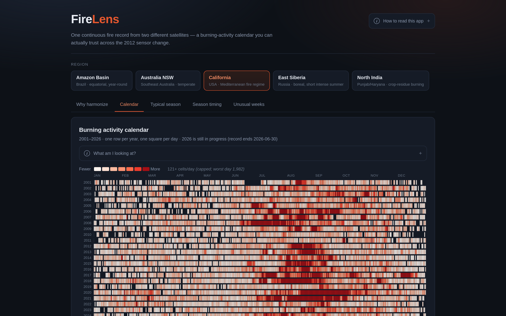
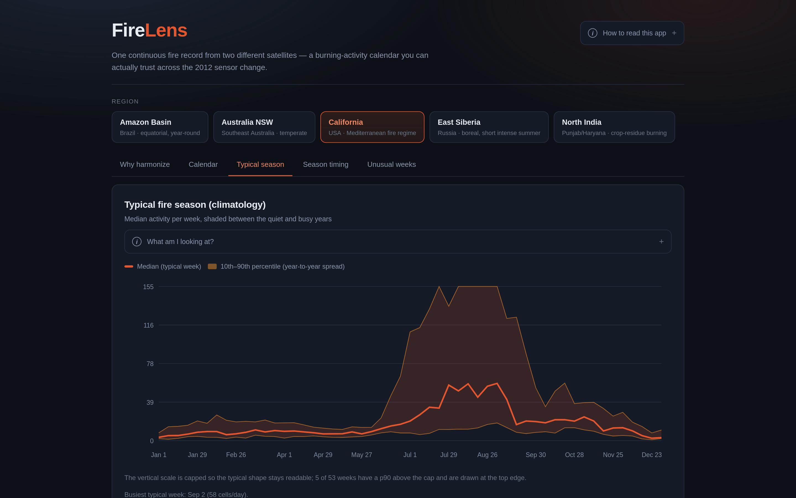
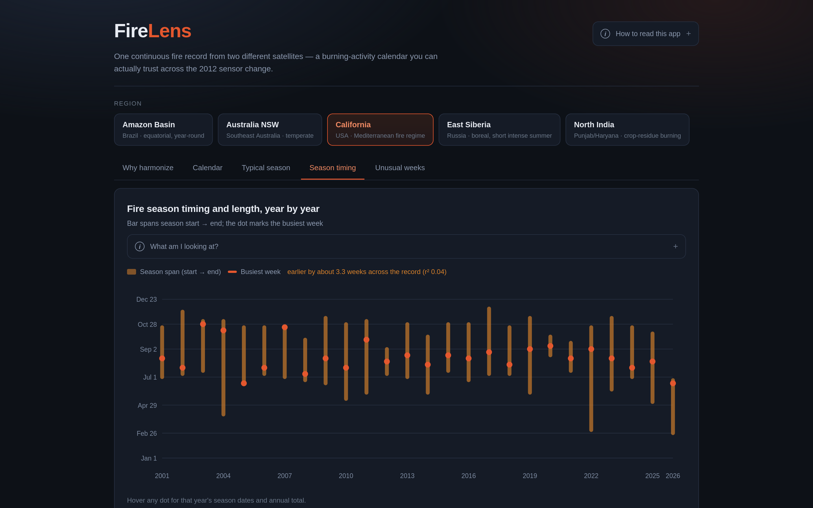
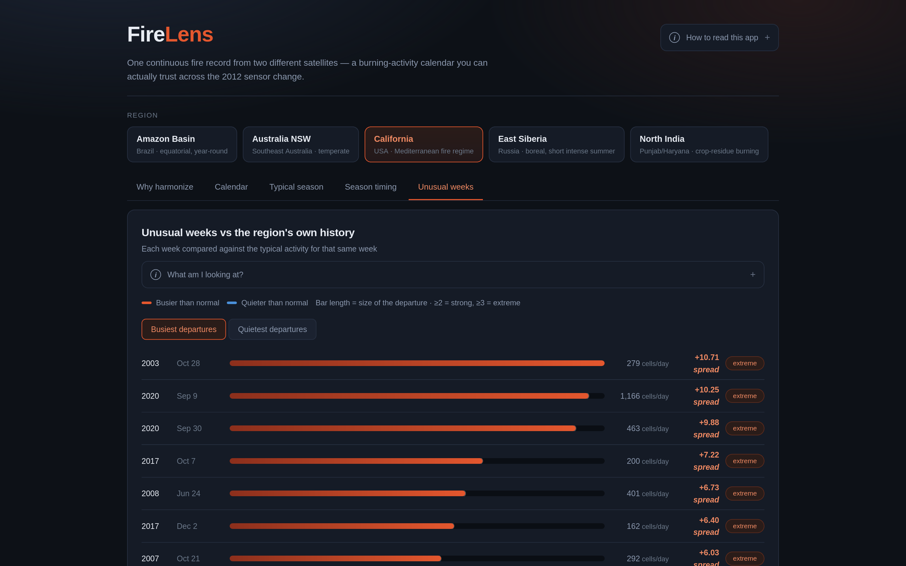
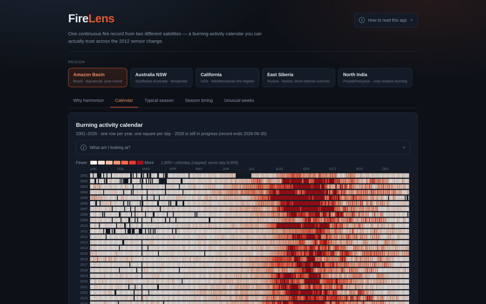
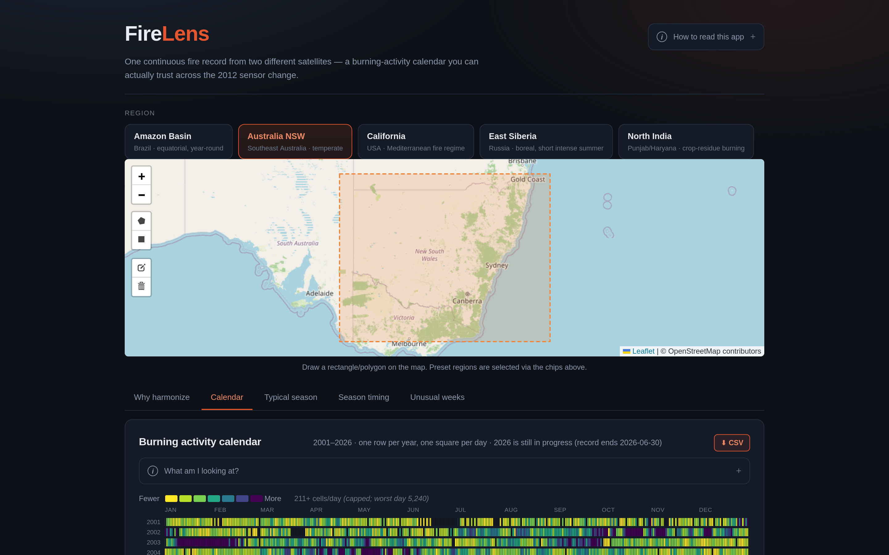
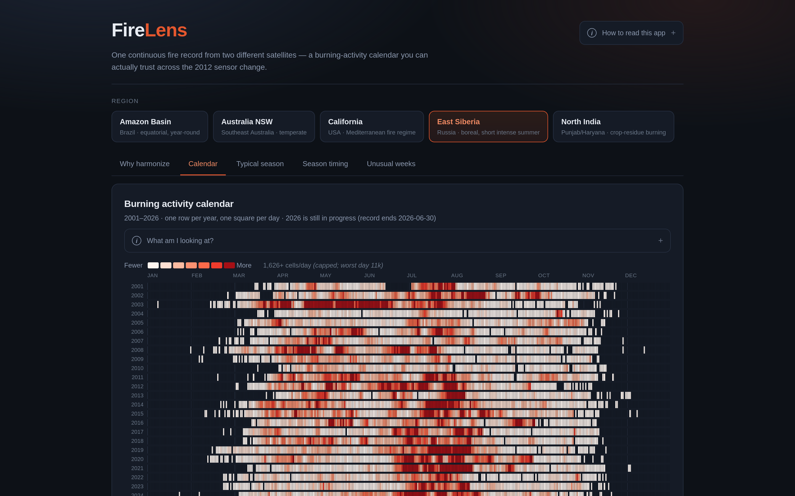

# FireLens

**A harmonized burning-activity calendar for emergency managers — one continuous
fire record from two different satellites, enabling early warning and response
across the 2012 sensor change.**

NASA Space Apps Challenge 2026 · *Harmonization of MODIS and VIIRS Hot Spots*

team **scikit** — M. Shahmir Khan · Ahmed Bilal · Abbas Bajwa · Azwar Khan · Sajid Islam

<!-- notes:
Open on the one-line pitch. "Two satellites have watched Earth's fires for 25
years. We made their records comparable, so a change you see is real fire — not
a change of instrument."
-->

---

## The problem — fire managers need one consistent calendar

NASA FIRMS publishes active-fire hotspots from two satellites at very different
resolutions:

| Sensor | Resolution | Overpasses/day | Archive |
|---|---|---|---|
| **MODIS** C6.1 (Terra/Aqua) | 1 km | 4 | 2001 → present |
| **VIIRS** S-NPP | 375 m | 2 | 2012 → present |

Both observe *the same fires* — but VIIRS reports **2.2×–4.9×** as many distinct
fire cells as MODIS, purely because its pixels are finer.

Emergency managers need to **compare a current fire against historical patterns**,
recognize changes relative to the multi-year median, and strengthen forecasting.
But the two sensors cannot be compared directly — their records are split across
instruments whose data cannot be harmonized without a consistent method.

<!-- notes:
Stress: this is a measurement artifact, not a real change on the ground. A 375 m
pixel is ~7x finer than a 1 km pixel, so a finer sensor mechanically finds more
"hot spots" in the same fire.
-->

---

## The overlap is what makes this solvable

The two archives **overlap for ~14 years** (2012 → present) — they do *not* hand
off at a single date.

For more than a decade, both instruments look at the **same burning ground** and
disagree in a measurable way. That overlap lets us *fit* the correction instead
of guessing it.

Without a fix you get a **fictional spike in 2012** — activity "explodes" the
moment the satellite changes.

<!-- notes:
This is the key insight of the project. The overlap turns an opinion ("VIIRS sees
more") into a number we can calibrate against.
-->

---

## What FireLens does — for emergency managers

1. **Downloads** 26 yrs MODIS + 15 yrs VIIRS for five regions (26.2M detections)
2. **Cleans** — confidence thresholds, drop volcano/offshore, drop FRP ≤ 0
3. **Grids** every detection onto a common **~1 km H3** lattice (kills pixel-size inflation)
4. **Calibrates** VIIRS onto the MODIS scale using the 2012→present overlap
5. **Publishes** the result as an interactive **burning-activity calendar**

Output: **one defensible activity series, 2001 → today**, where year-over-year
change reflects **real fire**, not a change of satellite.

**Emergency managers can now:**
- Select a region and date range → download analytics & visualizations
- See which months/years had the highest fire activity
- Compare current burning against the historical median
- Export CSV of harmonized hotspots for their own tools

---

## Pipeline

```
FIRMS API
   │
   ├─ 1. CLEAN      confidence 'low' (VIIRS) / <25 (MODIS),
   │                remove {volcano, static/offshore}, drop FRP ≤ 0
   │
   ├─ 2. GRID       lat/lon → H3 res 8 (~0.7 km²)   ← kills pixel inflation
   │                per day: count unique fire cells, sum FRP
   │
   ├─ 3. CALIBRATE  OLS  MODIS ~ a + b·VIIRS  fit on 2012→present overlap
   │                MODIS days keep measured value; MODIS gaps ← calibrated VIIRS
   │                merged.parquet keeps modis / viirs / harmonized side by side
   │
   └─ 4. CALENDAR   weekly climatology (p10/median/p90)
                    anomaly    = (value − median) / (p90 − p10)
                    peak season = cumulative 20% / argmax / cumulative 90%
                    year × day-of-year heatmap grid
```

The correction stays **auditable** — the raw and corrected series live side by
side in every artifact.

---

## Results — all five regions

| Region | VIIRS over-report | FRP ratio | Overlap days | Calibration R² | Peak week | Busiest year |
|---|---|---|---|---|---|---|
| California | 2.31× | 0.49 | 4,653 | 0.922 | 36 (early Sep) | 2020 |
| North India | 4.90× | 1.69 | 4,327 | **0.586** | 44 (early Nov) | 2016 |
| Amazon Basin | 2.31× | 0.89 | 5,090 | 0.901 | 36 (early Sep) | 2005 |
| Australia NSW | 2.98× | 0.74 | 4,946 | 0.917 | 16 (mid Apr) | 2019 |
| East Siberia | 2.41× | 0.59 | 3,506 | 0.952 | 29 (mid Jul) | 2003 |

**28,287,761** raw detections → **42,949** harmonized region-days →
**6,910,569** cell-days.

Five fire regimes, one method: Mediterranean · monsoon crop-residue · equatorial ·
temperate · boreal.

<!-- notes:
R2 of 0.90-0.95 for genuine wildfire. The exception is North India — call it out
proactively on the next slide.
-->

---

## The web app — five views

Every view has a **"What am I looking at?"** explainer, hover/click readouts, and **CSV export**:

1. **Why harmonize** — MODIS, VIIRS and the harmonized series on one axis; watch
   them disagree across 14 yrs of overlap and the correction bring them together.
2. **Calendar** — one row/year, one square/day; the fire season reads as a drifting band.
3. **Typical season** — weekly median with a p10–p90 band (narrow = predictable).
4. **Season timing** — per-year start/peak/end bars + a computed drift trend.
5. **Unusual weeks** — weeks ranked by robust p10–p90 anomaly (a substitute for σ
   that a single extreme week cannot fool).

**New interactive features for emergency managers:**
- **Map-based AOI selection** — draw a rectangle/polygon or click a preset region
- **CSV download** on every view → plug directly into your own tools
- **Colorblind-safe palettes** (viridis) for accessible visualizations


---

## Screens









---

## Regions span five fire regimes







Equatorial year-round · temperate Dec–Feb peak · boreal short intense summer.

---

## Known weakness — North India (R² 0.586)

North India's **4.9×** inflation and sharply-peaked Oct–Nov crop-residue burning
sit far outside what the other regions show, so a linear overlap fit explains far
less variance there.

- The trend is likely **genuine** — agricultural burning is a distinct regime.
- The calibration is the **least trustworthy** of the five.

**Flagged, not hidden.** A regime-aware / nonlinear fit is the next step.

<!-- notes:
Judges reward honesty. Presenting this as a strength: we looked, we measured, we
told you where our method is weak.
-->

---

## Limitations & next steps

- **MODIS is the reference scale** — output is "MODIS-equivalent," the honest label.
- **Harmonized series prefers measured MODIS** (overlap ≈ 14 yrs); VIIRS fills gaps.
  VIIRS-calibrated share of post-2012 cell-days is **0.01%–0.9%** — the correction
  fixes *dates*, not the magnitude of the record.
- **Per-region linear fit** — simple and inspectable; nonlinear fit for crop burning.
- **Map-based AOI selection added** — custom areas use nearest preset's data.
- **Cloud-edge artifacts** not modelled — partly absorbed by the overlap average.

---

## Try it / verify it

```bash
scripts/bootstrap.sh --dev        # venv + Python + frontend deps
scripts/build_all.sh              # rebuild all five regions (~11 min)
.venv/bin/python -m pytest tests/ -q   # 20 tests
# API + frontend, then open http://127.0.0.1:4173
```

- **Data:** NASA FIRMS — MODIS C6.1 (1 km) + VIIRS S-NPP (375 m), 2001 → present
- **Code:** github.com/shahmirkhan106/firelens
- **License:** MIT

**FireLens — a change you see is real fire, not a change of instrument.**

<!-- notes:
Close on the repository and the one-line pitch. Invite the judge to run the tests
and the pipeline themselves.
-->
