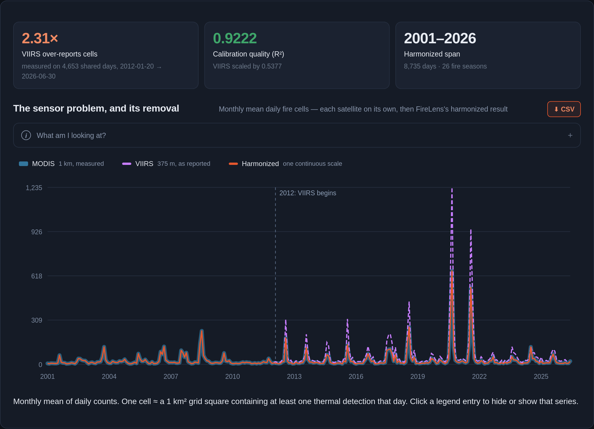
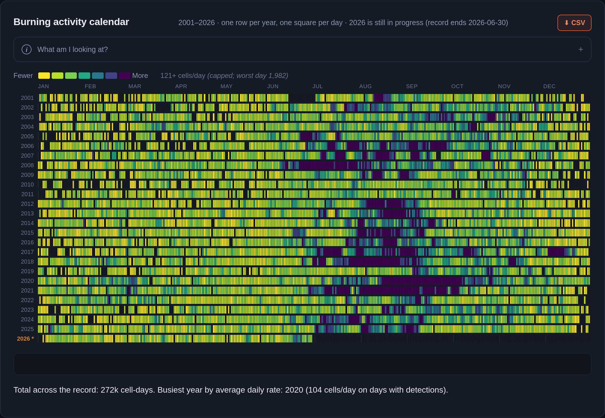

# FireLens

**One continuous fire record from two satellites.**

A harmonized burning-activity calendar for emergency responders, scientists, and
land managers — built from NASA FIRMS MODIS + VIIRS active-fire hotspots.

NASA Space Apps Challenge 2026 · *Harmonization of MODIS and VIIRS Hot Spots*

team **scikit** — M. Shahmir Khan · Ahmed Bilal · Abbas Bajwa · Azwar Khan · Sajid Islam

---

## The problem — a 2012 sensor break

| Sensor | Resolution | Archive |
|---|---|---|
| **MODIS** C6.1 (Terra/Aqua) | 1 km | 2001 → 2026 |
| **VIIRS** S-NPP | 375 m | 2012 → 2026 |

Both observe *the same fires*, but VIIRS reports **2.3×–4.9×** as many distinct
fire cells purely because its pixels are finer.

Join the archives without correction and you invent a **fictional spike in
2012**: activity appears to explode when the satellite changes, not the planet.

---

## The fix — measure the correction, don't guess it

The two archives overlap for **~14 years** (2012 → June 2026), so both
instruments watch the same burning ground and disagree in a measurable way.

1. **Clean** — confidence thresholds, remove volcano/offshore types, drop FRP ≤ 0.
2. **Grid** — project every detection onto a common **~1 km H3** lattice.
3. **Calibrate** — OLS `MODIS ~ a + b·VIIRS` fitted on the overlap; MODIS days
   keep their measured value, MODIS gaps fall back to calibrated VIIRS.
4. **Publish** — one "MODIS-equivalent" series, 2001 → June 2026.

Raw MODIS, raw VIIRS, and harmonized values stay side by side, so the correction
is auditable.

---

## NASA data and results

**Data:** NASA FIRMS — MODIS C6.1 (1 km) + VIIRS S-NPP (375 m), five regions
spanning Mediterranean, monsoon crop-residue, equatorial, temperate, and boreal
fire regimes.

- **28,287,761** raw detections processed
- **42,949** harmonized region-days · **6,910,569** cell-days
- Calibration **R² 0.90–0.95** for genuine wildfire
- Honest exception: North India crop burning **R² 0.59**, flagged not hidden

---

## The app — five views, one calendar





**Why harmonize** · **Calendar** · **Typical season** · **Season timing** · **Unusual weeks**

Each view has a "What am I looking at?" explainer, hover/click readouts, and a
view-specific CSV export. Draw an area on the map to use the nearest processed
region.

---

## Impact

Emergency responders, scientists, and land managers can:

- compare current burning against the historical median,
- see which months/years had the highest activity,
- identify unusual weeks and critical periods,
- export the harmonized hotspots for their own tools.

**Known limit:** MODIS is the reference scale; the output is explicitly
"MODIS-equivalent." North India's linear fit is the weakest and is reported as
such.

---

## Try it / verify it

```bash
scripts/bootstrap.sh --dev
scripts/build_all.sh
.venv/bin/python -m pytest tests/ -q   # 21 tests
# API + frontend, then open http://127.0.0.1:4173
```

- **Code:** https://github.com/shahmirkhan106/firelens
- **Demo video:** `docs/firelens_demo.mp4` (30s)
- **Full deck:** `docs/DECK.md`
- **License:** MIT

**FireLens — a change you see is real fire, not a change of instrument.**
